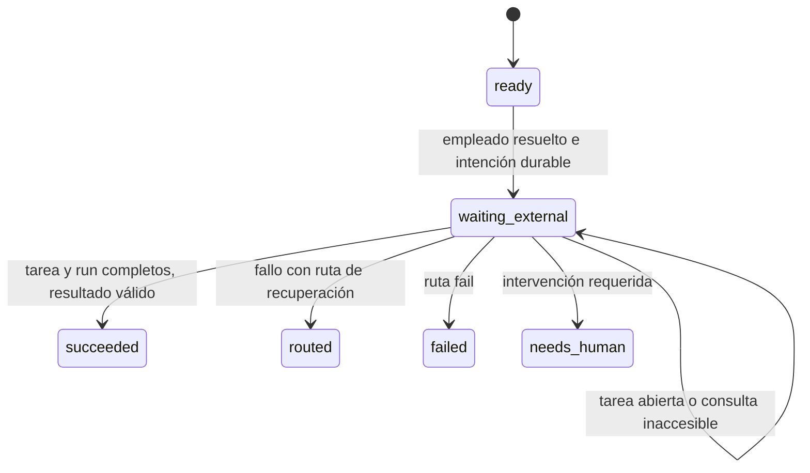

# Ejecución durable de pasos externos

### Outcome

Un paso que hoy delega una tarea de coding a Claude o Codex puede usar como
ejecutor a un agente de Paperclip mediante su API. El cambio de ejecutor
conserva el propósito del paso, sus instrucciones y el contrato de resultado
que necesita el resto del flow. Paperclip notifica la finalización a la API de
Orquesta; esa notificación solicita al motor comprobar el resultado y reanudar
la misma corrida por la ruta declarada.

Un flow puede combinar ejecutores síncronos con trabajo delegado a Paperclip.
La corrida conserva su definición, se suspende sin mantener un proceso vivo y
se recupera por notificación o reconciliación. Orq-lite valida el resultado y
decide cada transición.

### Non-goals

- Paperclip no selecciona sucesores ni modifica el flow.
- Orq-lite no aloja el webhook público ni requiere MCP.
- No se incorpora otro motor, una cola distribuida o una sintaxis alternativa
  de saltos entre pasos.
- No se descargan ni ejecutan comandos contenidos en entregables o evidencia.
- Esta integración no agrega una funcionalidad de importación de repositorios
  ni rediseña la intervención humana. Conserva las validaciones y controles
  requeridos por el flow y por el protocolo de ejecución durable.

### Constraints and invariants

- La base de implementación es `origin/main`, inicialmente `292b2a2`.
- Un intento conserva el empleado resuelto, instrucciones, deadline, clave de
  idempotencia y referencias conocidas después de un reinicio.
- Reanudar o volver a consultar un intento no crea otro intento ni gasta otro
  cupo de ejecución. Un reintento explícito usa un ID y una clave nuevos.
- Una notificación es una solicitud de consulta, nunca una prueba de éxito.
- Una decisión terminal, el estado del paso y su evento se guardan en la misma
  transacción. Un intento anterior no puede modificar el vigente.
- Un fallo encaminado a una rama de recuperación conserva su resultado de
  fallo: el paso queda `routed` y el intento `failed`.
- El trabajo previo debe estar terminado o tener cancelación confirmada antes
  de habilitar un reintento. Un despacho incierto se reconcilia primero.
- Los flujos y ejecutores síncronos conservan sus contratos y sus claves.

### Design

#### Modules and seams

`internal/flow` compila y fija los recursos y contratos declarados.
`internal/workflow` coordina el estado durable, inbox, validación, decisiones,
controles y recuperación. `internal/external` define el adaptador neutral al
transporte y su implementación REST de Paperclip. CLI y vista consultan estas
capacidades; el host Orquesta autentica los webhooks y ejecuta la reconciliación.

#### Interfaces and contracts

La frontera funcional es la invocación del agente: asignar el trabajo por API,
esperar y recuperar su resultado. La notificación contiene correlación; nunca
una instrucción para seleccionar al siguiente agente. El resultado de Paperclip
debe adaptarse al contrato del paso; la metadata de transporte, espera y costo
permanece disponible para observabilidad.

El paso usa `activity:external.dispatch@1` con entradas tipadas en `with`:

- `adapter`, `employee`, `instructions`, `completionCondition` y
  `timeoutSeconds` son obligatorios.
- `completionCondition` describe al empleado la condición de entrega. Las
  comprobaciones automáticas adicionales se expresan mediante `outputSchema`
  y `completionGate`, evaluado sobre el resultado tipado como `item`.
- `requireEvidence` vale verdadero por defecto.
- `outputMode: "deliverables"` conserva el JSON esperado por los pasos
  posteriores al reemplazar una invocación de coding. El schema fijado se envía
  junto con la tarea; la metadata externa se consulta por separado.
- `projectId` fija opcionalmente el proyecto Paperclip de la asignación.
- `routes` relaciona resultados con `continue`, `fail` o `needs_human`.
  `unavailable` también admite `wait`, su comportamiento predeterminado.

El adaptador expone `ResolveEmployee`, `Dispatch`, `Inspect` y `Cancel`.
`Dispatch` recibe una asignación ya resuelta y una clave derivada del intento.
`Inspect` devuelve estados de issue/run, agente responsable, entregables,
evidencia y uso disponible. No recibe instrucciones sobre la transición.

`ResumeExternal(runID, stepID, attemptID, event)` guarda el evento antes de
procesarlo. El ID del intento identifica la instancia concreta y se verifican
también la corrida y el ID lógico del paso, incluso en ámbitos repetidos.
Correlaciones desconocidas se rechazan; eventos de intentos obsoletos se
registran como ignorados.

El puente `flow external receive` devuelve un recibo durable sin cargar
credenciales ni tomar el lock del ejecutor. Un proceso de reconciliación separado usa
`ReconcileExternal`, `RunExternalReconciler` o `flow external watch`. El host
debe iniciar ese proceso de reconciliación al arrancar; `watch` consulta cada treinta segundos.

La salida del paso es `{outcome, decision, result}`. Las ramas se declaran con
los `if` existentes sobre `outcome`; no se agregan saltos arbitrarios.

#### Data model

SQLite mantiene las corridas, pasos e intentos existentes y agrega:

- `external_attempts`: asignación, request, referencias, último resultado,
  decisión, timestamps y respuesta de cancelación.
- `external_events`: recepción durable y deduplicada por intento/evento,
  incluyendo disposición pendiente, procesada o ignorada.
- `external_usage`: observaciones acumulativas por intento y run externo.

El outbox existente conserva los eventos de preparación, despacho,
comprobación, recepción, decisión, reintento y cancelación. No se agregan tablas
paralelas para representar la misma transición lógica. Las migraciones son
aditivas y transaccionales; se conserva el uso ya guardado por la versión
anterior del esquema externo.

Costo y tokens ausentes permanecen desconocidos. Un cero informado se conserva
como cero. Las consultas repetidas actualizan el mismo run; observaciones
anteriores o sin métricas no reducen el gasto ni lo suman nuevamente. El costo
conocido acumulado alimenta los presupuestos existentes.

#### State and flow

Antes de crear la tarea se guarda la intención. Un reinicio recupera esa
intención y reutiliza la clave; una referencia ya confirmada se consulta sin
volver a despachar. El callback temprano permanece pendiente hasta que pueda
comprobarse el estado autoritativo.

La suspensión se propaga sin ejecutar compensaciones ni validación de cierre
como si fuera un fallo. La recuperación también contempla el reinicio después
de guardar la decisión y antes de ejecutar el siguiente paso.

Pausar impide nuevas intenciones y avances. Una asignación reclamada antes de
la pausa puede terminar de registrar sus referencias. Cancelar detiene primero
la ejecución local y solicita la cancelación externa, registrando si fue
confirmada; una respuesta tardía no reactiva la corrida. Reintentar una corrida
pausada conserva la pausa. El nuevo intento vuelve a resolver el empleado,
mientras el anterior conserva su resolución histórica.

#### Failure behavior

| Resultado | Comportamiento predeterminado |
| --- | --- |
| `success` | Continúa únicamente tras validar issue, run, agente, entregables, evidencia y gates |
| `waiting` | Sigue esperando; `run.finished` con issue abierta no avanza |
| `timeout` | Solicita cancelación y requiere intervención |
| `cancelled`, `blocked`, `failed` | Requiere intervención |
| `unavailable` | Mantiene la espera y vuelve a consultar hasta el deadline |
| `invalid` | Requiere intervención; incluye agente incorrecto, contrato, gate o uso inválido |

Las rutas explícitas del flow pueden seleccionar recuperación o fallo. Ningún
resultado no exitoso se transforma implícitamente en éxito. Los plazos son UTC
absolutos y consumen tiempo durante espera, pausa y caída del host. Un resultado
comprobado después del plazo no supera la condición temporal. El presupuesto de
duración de la corrida también solicita limpieza externa cuando vence.

Paperclip debe implementar la creación atómica con `idempotencyKey` en el body.
El adaptador se basa en ese contrato, no en un header de idempotencia. Un
despacho incierto de seis días o más no se reenvía: requiere intervención por
defecto y conserva la incertidumbre, evitando superar la retención de claves
del proveedor. Con referencias confirmadas, la inspección puede continuar sin
otro create.

La evidencia incluye referencias persistidas de documentos y work products;
no se descargan URLs arbitrarias. Los estados de issue y run se consultan por
separado y el agente que produjo el run debe coincidir con la asignación fijada.

#### Test seams

Las pruebas del motor usan un adaptador y reloj controlados con SQLite real en
un directorio temporal. Las pruebas del adaptador y del recorrido CLI completo
usan un servidor HTTP de prueba con el protocolo verificado de Paperclip.
Los puntos de prueba incluyen antes/después del despacho, recepción temprana,
decisión ya confirmada, pausa concurrente, deadline y cancelación rechazada.

### Decisions

- Se extiende la actividad versionada existente; un bloque nuevo de lenguaje
  no aporta comportamiento necesario para este requerimiento.
- La instancia se identifica por intento, verificando además corrida y paso;
  no se depende de una búsqueda ambigua por nombre de paso.
- Se reutiliza el propietario local del scheduler y su outbox. Los leases
  distribuidos quedan fuera del alcance de este motor local.
- (ADR candidate) La intención anterior al efecto y la decisión junto con su
  transición son los límites durables del protocolo.
- El host conduce la reconciliación; el adaptador no controla el flow ni
  mantiene un loop propio.
- La resolución puede cambiar entre reintentos explícitos, nunca dentro del
  intento en curso.
- Se evita el solapamiento de reintentos de manera predeterminada; una falla
  de cancelación no equivale a autorización para asignar otra tarea.

### Verification

- Gate general: `go test -race ./...`.
- Compilación: contratos requeridos, rutas inválidas y schema de entregables
  fijado en el IR.
- Motor: reinicio, mismo intento tras despacho incierto, duplicados, intentos
  antiguos, callback temprano, gates/evidencia inválidos y continuación única.
- Recuperación: callback perdido, límites de intentos, pausa concurrente,
  deadline global, cancelación y reintentos sin superposición.
- Uso: runs repetidos, distintos y métricas ausentes; conservación de ceros,
  presupuesto acumulado y migración de registros anteriores.
- Integración: CLI con pasos síncronos, Paperclip HTTP, recibo durable, SQLite y
  reanudación. Vista comprobada en navegador con datos de prueba.

### Integration delivery status

El motor, el adaptador REST, el relay Paperclip, la recepción durable por API/CLI
y la integración con Orquesta están implementados localmente. El recorrido
verificado con binario Go real y HTTP controlado incluye:

- Recepción/autenticación de la notificación y correlación con corrida,
  paso e intento antes del recibo durable.
- Ejecución de la reconciliación al arrancar y durante la vida del host.
- Seguimiento de una corrida en `waiting_external` aunque su proceso local
  termine: el supervisor de Orquesta debe consultar el estado durable.
- Consumo del resultado por los pasos existentes del flow con el contrato
  esperado por el rol de coding.
- Pruebas de reinicio y entrega duplicada o perdida de notificaciones.

Para activar la integración en un entorno desplegado deben instalarse el
binario actualizado y el relay, aplicarse la migración de Orquesta y configurar
la referencia de secreto del callback. La prueba con una instancia real de
Paperclip sigue siendo una comprobación del entorno, no una prueba ejecutada
por la suite con HTTP controlado.

La finalización de un proceso local y la finalización de un run en Paperclip
no sustituyen a la decisión del motor sobre el paso.

### Out of scope / parked

- Descargar/materializar un repositorio o revisión externa para correr gates
  contra otra copia de trabajo: no todo entregable es un cambio de código.
- Introducir una DSL de validación, comandos tomados de evidencia, múltiples
  propietarios distribuidos o un endpoint público dentro del motor.
- Una prueba contra una instancia desplegada de Paperclip requiere el entorno
  de integración correspondiente; los tests del repositorio usan HTTP
  controlado y contratos contrastados con el código upstream.

## Flows mixtos y espera durable

Un flow declara trabajo externo, fija la asignación, se suspende y conserva los
resultados síncronos ya terminados.

Acceptance criteria:
- `external.dispatch@1` rechaza campos obligatorios ausentes, plazo inválido y rutas inválidas.
- La corrida y el paso muestran `waiting_external` después del despacho.
- Reabrir SQLite conserva el mismo intento, empleado y clave sin repetir pasos síncronos completos.
- Recuperar un despacho sin confirmación reutiliza la misma request y clave.

Evidence:
- Pruebas de compilación y de reinicio/dispatch incierto del motor.

Depends on: none

## Recepción y decisión verificadas

El host entrega identificadores a una recepción durable; el motor consulta,
valida y confirma una única decisión lógica.

Acceptance criteria:
- El evento se conserva antes del recibo incluso con credenciales ausentes o ejecutor ocupado.
- Dos eventos iguales producen como máximo una decisión y un avance.
- Un evento de otro intento no altera el vigente.
- Un callback anterior al registro de referencias permanece pendiente.
- Un run finalizado con issue abierta mantiene la espera.
- Schema, evidencia, agente o gate inválidos impiden el éxito.
- Una issue completada con evidencia válida ejecuta la rama declarada una vez.

Evidence:
- Pruebas del inbox, CAS concurrente, callback temprano y validación del motor.

Depends on: Flows mixtos y espera durable

## Adaptador Paperclip y puente del host

El mismo recorrido funciona con el protocolo REST de Paperclip y una recepción
invocable desde Orquesta sin alojar el webhook en orq-lite.

Acceptance criteria:
- Crear una issue transmite la clave por intento en `idempotencyKey`.
- La inspección obtiene issue, ejecución actual, agente, entregables y evidencia persistida.
- Las referencias de evidencia usan recursos existentes del proveedor.
- El puente CLI devuelve un recibo durable y permite reconciliar desde otro proceso.
- Un flow completo combina gates síncronos con un paso Paperclip.

Evidence:
- Pruebas HTTP del adaptador y `TestExternalPaperclipCLIMixedFlowReceivesAndReconcilesDurably`.

Depends on: Recepción y decisión verificadas

## Recuperación y control de intentos

Un proceso de reconciliación del host procesa la misma decisión por callback o consulta periódica,
respetando pausa, cancelación, deadlines y reintentos explícitos.

Acceptance criteria:
- La consulta periódica completa el recorrido aunque se pierda el callback.
- Una decisión confirmada antes de un reinicio no deja su continuación detenida.
- Una pausa concurrente no se borra mediante reconciliación automática.
- Los resultados de timeout, cancelación, bloqueo, ejecución fallida e indisponibilidad siguen su ruta sin éxito implícito.
- Un reintento nuevo conserva el historial y no se habilita mientras el trabajo anterior sea incierto o siga sin cancelación confirmada.
- La corrida cancelada no despacha ni avanza por eventos tardíos.

Evidence:
- Pruebas de recuperación, resultados explícitos, pausa, cancelación, cutoff y reintentos sin superposición.

Depends on: Adaptador Paperclip y puente del host

## Observabilidad y uso reportado

CLI, API y vista muestran el trabajo externo y conservan su uso sin convertir
información ausente en un importe inventado.

Acceptance criteria:
- La vista y API muestran estado, empleado, issue/run, espera, intentos, última comprobación, decisión y cancelación.
- El uso se acumula por run sin duplicar callbacks ni reducir gasto ante observaciones antiguas.
- Una métrica desconocida se distingue de un cero informado.
- El costo reportado alimenta los presupuestos existentes y se conserva al migrar.
- La suite de ejecutores síncronos sigue pasando.

Evidence:
- Pruebas de store/migración/uso, API y suite general; comprobación visual de la tabla.

Depends on: Recuperación y control de intentos
